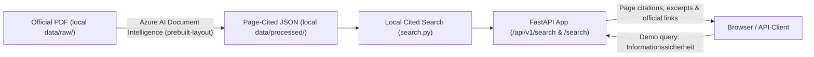
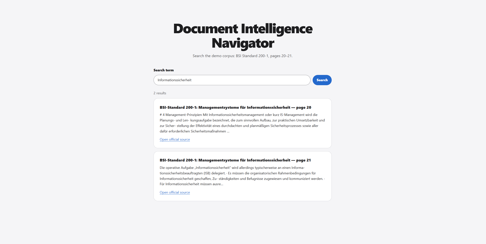

# EU Security & Privacy Document Intelligence Navigator

Azure-based portfolio project that turns official EU and German security and privacy documents into searchable, page-cited knowledge.

> Information-retrieval demonstrator only. It does not provide legal advice or compliance certification.

## Current Scope

This repository is a working local demonstrator focused on traceable extraction and cited search:

- **Source Governance & Registry**: Documented reuse policy ([docs/source-policy.md](docs/source-policy.md)) and initial official source registry ([sources/registry.yml](sources/registry.yml)) covering GDPR/DSGVO, EU AI Act, NIS2, BDSG, and BSIG. Full ISO standards and private/customer documents are deliberately excluded.
- **HTML Ingestion & Legal Chunking**: Reproducible download, SHA-256 hashing, HTML text normalisation (`ingestion.py`), and article-level citation chunking (`chunking.py`).
- **Azure AI Document Intelligence Extraction**: Local PDF page analysis with the `prebuilt-layout` model (`document_analysis.py`, `scripts/demo_document_intelligence.py`) returning Markdown content and per-page citation payloads saved locally under `data/processed/` (gitignored).
- **Local Cited Search & Web UI**: Keyword search over saved Document Intelligence JSON files (`search.py`), exposed through a FastAPI backend (`/api/v1/search`, `/health`, `/docs`) and a lightweight search page (`/search`) returning page citations, cleaned excerpts, and official source links.
- **Demo Corpus**: Verified locally on **BSI-Standard 200-1** (pages 20–21).
- **Automated Checks**: GitHub Actions CI runs Ruff and pytest on Python 3.12 without Azure credentials or local extracted data.

## Architecture



## Azure vs. Local Execution

| Step | Needs Azure? | Needs Saved Local Results? | Notes |
| --- | --- | --- | --- |
| `ruff check .` & `pytest` | No | No | Uses unit mocks and temporary fixtures only. |
| `python scripts/demo_document_intelligence.py` | **Yes** | Writes `data/processed/*.document-intelligence.json` | Requires `.env` credentials and `data/raw/bsi-standard-200-1.pdf`; analyses pages 20–21 with `prebuilt-layout`. |
| FastAPI app (`/search`, `/api/v1/search`, `/health`) | No | **Yes** (for non-empty search results) | Reads previously saved `data/processed/*.document-intelligence.json` locally with no Azure API calls. |

## Windows PowerShell Quickstart

### 1. Create a Python 3.12 environment and install dependencies

```powershell
py -3.12 -m venv .venv
.\.venv\Scripts\Activate.ps1
python -m pip install --upgrade pip
pip install -e ".[dev]"
```

### 2. Run linting and unit tests (no Azure credentials or local data needed)

```powershell
ruff check .
pytest
```

### 3. Extract demo pages with Azure AI Document Intelligence (Azure step)

Skip this step if you already have `data/processed/bsi-standard-200-1-pages-20-21.document-intelligence.json` saved locally.

1. Copy `.env.example` to `.env` and fill in your Azure AI Document Intelligence endpoint and key:
   ```powershell
   Copy-Item .env.example .env
   ```
2. Place the official BSI-Standard 200-1 PDF at `data/raw/bsi-standard-200-1.pdf` (both `data/raw/` and `data/processed/` are gitignored).
3. Run the extraction demo (analyses pages 20–21 and saves page-cited JSON locally):
   ```powershell
   python scripts/demo_document_intelligence.py
   ```

### 4. Start the FastAPI server and run the demo query (local-only step)

```powershell
uvicorn eu_security_navigator.main:app --reload
```

- **Search UI**: Open `http://127.0.0.1:8000/search` and submit the demo query **`Informationssicherheit`**.
- **JSON API**:
  ```powershell
  Invoke-RestMethod "http://127.0.0.1:8000/api/v1/search?q=Informationssicherheit"
  ```
- **API Docs & Health**: `http://127.0.0.1:8000/docs` and `http://127.0.0.1:8000/health`.

With the saved BSI-Standard 200-1 extraction in `data/processed/`, searching **`Informationssicherheit`** returns citations for **BSI-Standard 200-1 — page 20** and **page 21**, each with a cleaned excerpt, match score, and direct link to the official BSI PDF.



## Responsible Data Handling

Only official sources with documented reuse rights are included. The repository stores source metadata, licence notes, ingestion/extraction code, tests, and small inline test fixtures—never private data, raw/processed documents, or Azure credentials.

See [Source Policy](docs/source-policy.md).

## Future Work: Enterprise & Cloud Deployment

The current implementation intentionally runs search and serving locally to keep costs minimal during early development. Planned enterprise-grade extensions include:

- **Azure AI Search**: Replace local JSON term matching with managed hybrid/semantic search across full multi-document corpora (PDF layout extractions and legal HTML chunks).
- **Azure AI Content Safety**: Screen public queries before search execution.
- **Managed Storage & Ingestion Pipelines**: Store raw and processed artifacts in Azure Blob Storage with automated ingestion jobs (e.g., Azure Functions) and index versioning.
- **Production Web Hosting & UI**: Dedicated frontend hosting (e.g., Azure Static Web Apps with React + TypeScript) backed by containerised FastAPI services (Docker).
- **Enterprise Security & Operations**: Infrastructure-as-Code with Bicep, Microsoft Entra ID with Managed Identity and RBAC (replacing key-based credentials), and Azure Cost Management budgets and alerts.

## Licence

The project source code is released under the MIT License. Third-party documents remain subject to their respective official reuse terms.
