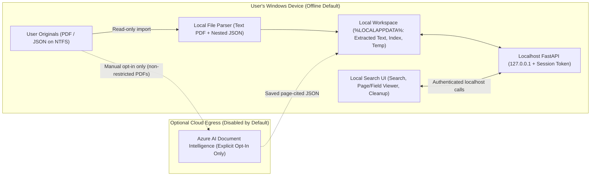

# Product Brief: Offline Document Intelligence Navigator (Windows-First, Single-User)

> Information-retrieval demonstrator and design brief. It does not provide legal advice or compliance certification.

## 1. Vision & Problem Statement

IT security practitioners routinely cross-reference dozens of local ISMS documents, internal security policies, audit evidence packages, and structured JSON exports (such as control assessments, configuration snapshots, or scanner outputs). Many of these files are confidential or restricted and cannot be uploaded to cloud search services, yet Windows built-in file search struggles with page-accurate PDF citations, nested JSON paths, and fast cross-file verification.

This brief defines **Release 1** of a **Windows-first, single-user, offline-by-default** evolution of the existing Document Intelligence Navigator repository. It builds on the current FastAPI search prototype while cleanly separating **what exists today** from **what is proposed**.

### Policy Separation: Public Repository vs. Local Practitioner Workspace

The repository's [Source Policy](source-policy.md) governs what may be ingested into the public demo or committed to Git (openly reusable official sources only; never private, customer, or confidential documents). In the proposed offline desktop workflow:

- **The Git repository** continues to store only code, documentation, and public or synthetic test fixtures.
- **The user's local workspace** (outside the Git tree, e.g., under `%LOCALAPPDATA%`) holds the practitioner's local ISMS documents and derived search artifacts strictly offline on their Windows machine.

---

## 2. First User Group & Release 1 Scope

### First User Group

**IT security practitioners on Windows laptops**—such as Information Security Officers (ISBs), GRC analysts, internal auditors, and security engineers—who need to search local ISMS manuals, internal policies, and structured JSON exports while disconnected or restricted from cloud uploads.

### In Scope for Release 1 (MVP)

1. **Offline Import (Text-Based PDFs & JSON)**:
   - Import individual files or local folders containing **text-based PDFs** and **JSON exports** without any network access.
   - Compute SHA-256 content hashes and track source file paths and metadata locally.
   - Detect image-only / scanned PDFs (pages with no extractable text) and surface an explicit warning rather than silently indexing empty pages.
2. **Cross-File Cited Search**:
   - Search across all imported PDFs and JSON files from a single local search box.
   - Return ranked matches with cleaned excerpts, filename, and exact citation coordinates:
     - **PDF**: physical page number (and printed page label when available).
     - **JSON**: exact nested field path (RFC 6901 JSON Pointer such as `/controls/1/evidence/owner` and readable key/value context).
3. **Open Cited Page or Field**:
   - Click a PDF result to open directly at the **cited page**.
   - Click a JSON result to open a local structured view focused/highlighted on the **cited nested field**.
4. **Session / Workspace Cleanup**:
   - Provide an explicit cleanup action to purge imported copies (if any), extracted text, search indexes, temporary files, and application logs for the session/workspace without deleting the practitioner's original files stored elsewhere on disk.

### Explicitly Out of Scope for Release 1

- Multi-user authentication, shared team servers, or cloud sync.
- Automatic cloud OCR or mandatory Azure connectivity (Azure AI Document Intelligence remains strictly optional and disabled by default).
- Full enterprise cloud stack listed as future work in the [README](../README.md) (Azure AI Search, Azure AI Content Safety, Azure Blob Storage, Azure Functions, React + Static Web Apps, Bicep).
- Automated compliance scoring, legal advice, or LLM answer generation.

---

## 3. What Exists Today vs. What Is Proposed

The table below distinguishes the implemented repository baseline from the proposed Release 1 offline application.

| Capability | Exists Today (Current Repository) | Proposed for Release 1 (Offline App) |
| --- | --- | --- |
| **Runtime & Packaging** | Python 3.12 virtualenv + `uvicorn eu_security_navigator.main:app` started from PowerShell (`pyproject.toml`). | Windows-first local launcher bound strictly to `127.0.0.1` (packaging format pending evidence; see Section 7). |
| **PDF Extraction** | Cloud-only via Azure AI Document Intelligence `prebuilt-layout` (`document_analysis.py`, `document_intelligence.py`, `scripts/demo_document_intelligence.py`) requiring `.env` credentials; no local PDF parser dependency. | **Offline-first local PDF text extractor** extracting per-page text and page boundaries locally; Azure AI Document Intelligence retained only as an explicit, disabled-by-default opt-in for scanned/complex non-restricted PDFs. |
| **JSON Support** | Only reads Azure Document Intelligence output schema (`*.document-intelligence.json`) in `search.py`; does not index arbitrary JSON exports or `*.chunks.jsonl`. | Recursive JSON parser indexing keys, primitive values, and exact nested paths (objects and arrays) from arbitrary local JSON exports. |
| **HTML Official Ingestion** | CLI scripts (`ingestion.py`, `chunking.py`) fetch official HTML sources from `sources/registry.yml` via `httpx` and split `Artikel`/`Article` sections into `.chunks.jsonl`. | Kept intact as optional tooling for official public corpora; not required for Release 1 offline practitioner workflows. |
| **Indexing & Search** | `search.py` scans `data/processed/*.document-intelligence.json` on every request with case-insensitive substring counting and hardcoded `SOURCE_METADATA` for `bsi-standard-200-1.pdf`. | Persistent local search index across all imported PDFs and JSON files with dynamic file metadata, phrase/token matching, and German/English text handling. |
| **UI & Citation Opening** | `main.py` serves `search.html` at `GET /search` and JSON at `GET /api/v1/search`; results show citation label, excerpt, and an external `https://` link (`Open official source`). | Local UI supporting file/folder import, filterable cross-file search, and **Open cited page** (PDF page *N*) or **Open cited field** (highlighted nested JSON path). |
| **Data Persistence & Cleanup** | Raw/processed files sit in gitignored repo folders `data/raw/` and `data/processed/`; `uvicorn` logs query strings to stdout; demo script prints `content[:2000]` to stdout; no cleanup command exists. | Managed local workspace under `%LOCALAPPDATA%` with log redaction (`no-store`, no query/content logging) and a deterministic **Clear session / purge workspace** workflow. |

---

## 4. Proposed Offline Architecture



---

## 5. Where Data Lives (Originals, Extracted Text, Indexes, Temp Files, Logs)

Understanding every location where document content or search queries can land is essential for IT security practitioners handling sensitive ISMS artefacts.

| Data Category | Exists Today (Dev Repo) | Proposed Release 1 (Windows-First App) | Lifecycle & Cleanup Rule |
| --- | --- | --- | --- |
| **Originals** | User-placed files in `<repo>\data\raw\` (e.g., `bsi-standard-200-1.pdf`, downloaded HTML). Gitignored. | Stay in the practitioner's existing folders (e.g., `Documents\ISMS\...`). Referenced read-only by path + SHA-256 hash rather than duplicated unless explicitly copied into a session. | **Never modified or deleted** by session cleanup when referenced in place. If a user opts into session-copied uploads, copies live under `%LOCALAPPDATA%\DocumentIntelligenceNavigator\sessions\<id>\copies\` and are removed on cleanup. |
| **Extracted Text** | `<repo>\data\processed\*.document-intelligence.json`, `<source_id>.json`, and `<source_id>.chunks.jsonl`. Gitignored. | `%LOCALAPPDATA%\DocumentIntelligenceNavigator\sessions\<id>\extracted\` (normalized per-page PDF text and flattened JSON field records). | Deleted on session cleanup or single-document removal. |
| **Indexes** | None (re-reads `data/processed/*.document-intelligence.json` on each request). | `%LOCALAPPDATA%\DocumentIntelligenceNavigator\sessions\<id>\index\` (e.g., local SQLite FTS5 DB or local index directory). | Closed and deleted on session cleanup. |
| **Temporary Files** | Python / OS temp files during HTTP download or file I/O (`%TEMP%`); `__pycache__`, `.pytest_cache`, `.ruff_cache` during dev. | App-scoped temp directory `%LOCALAPPDATA%\DocumentIntelligenceNavigator\sessions\<id>\tmp\` (avoiding shared `%TEMP%` where feasible). Also note browser/WebView cache if not suppressed with `Cache-Control: no-store`. | Cleared immediately after each parse job and wiped on session cleanup. |
| **Logs** | `uvicorn` stdout/stderr access logs (currently include `GET /api/v1/search?q=...` query strings); `scripts/demo_document_intelligence.py` prints `content[:2000]` to stdout. | `%LOCALAPPDATA%\DocumentIntelligenceNavigator\logs\` containing operational events only (timestamps, error codes, counts)—**never** raw excerpts, JSON values, credentials, or search query terms. | Rotated and purged on session cleanup; stdout debug previews disabled in app mode. |

---

## 6. Release 1 Acceptance Checks

All acceptance checks use **public or synthetic examples** and must pass on a standard Windows 11/10 machine with Python 3.12.

### AC-1: Disconnected Use (Full Offline Operation)
- **Setup**: Disconnect the Windows machine from all networks (Airplane mode or disabled network adapters) and ensure `.env` is absent or contains no Azure credentials.
- **Action**: Launch the application, import a synthetic text-based PDF (`synthetic-isms-policy.pdf`) and a synthetic JSON export (`synthetic-isms-controls.json`), execute a search query, and open a citation result.
- **Expected Result**:
  - Startup, import, indexing, search, and citation viewing all succeed with zero errors.
  - No Azure credential prompts or network timeouts occur.
  - Local network observation confirms **zero outbound network connections** from the application process.

### AC-2: Match on Page Five (PDF Citation & Navigation)
- **Setup**: Import a multi-page text-based PDF (for example, a synthetic 8-page `synthetic-isms-policy.pdf` containing the unique phrase `"Quarterly backup restoration drill"` on physical page 5, or a public multi-page BSI PDF with a known page-5 term).
- **Action**: Search for `"Quarterly backup restoration drill"` (or the known page-5 term) and click **Open cited page**.
- **Expected Result**:
  - Search returns a match attributing the hit to `synthetic-isms-policy.pdf` with `page_number = 5` (no off-by-one error caused by cover pages or 0-based indexing).
  - The returned excerpt displays clean, readable surrounding text without raw layout comments or broken control characters.
  - Clicking **Open cited page** opens the PDF directly at **page 5**.

### AC-3: Nested JSON Field Match (Path Citation & Navigation)
- **Setup**: Import a synthetic ISMS control assessment export (`synthetic-isms-controls.json`), for example:
  ```json
  {
    "assessment": {
      "framework": "ISMS-Internal-Baseline",
      "controls": [
        { "id": "CTRL-01", "status": "implemented", "evidence": { "owner": "Platform Team" } },
        {
          "id": "CTRL-02",
          "status": "in_progress",
          "evidence": {
            "owner": "Security Operations",
            "notes": "Key rotation procedure pending quarterly tabletop validation."
          }
        }
      ]
    }
  }
  ```
- **Action**: Search for `"tabletop validation"` and click **Open cited field**.
- **Expected Result**:
  - Search returns a match referencing `synthetic-isms-controls.json` with exact nested path `/assessment/controls/1/evidence/notes` (JSON Pointer) and an excerpt showing the matching value.
  - Clicking **Open cited field** opens the structured JSON view scrolled to and highlighting `assessment -> controls[1] -> evidence -> notes`.

### AC-4: Session Cleanup (No Residual Indexed Data)
- **Setup**: After completing AC-2 and AC-3 (so extracted text, index files, temp artifacts, and logs have been created for the session), record the synthetic marker terms (`"Quarterly backup restoration drill"` and `"tabletop validation"`).
- **Action**: Trigger **Clear Session / Cleanup** from the UI (or CLI command).
- **Expected Result**:
  - Subsequent searches for either marker term return `0` results.
  - Session directories for extracted text, search indexes, temporary files, and session logs under the app workspace are removed or emptied.
  - Scanning the app's managed workspace directory for either marker term returns **zero matches**.
  - The user's original source files outside the app workspace remain intact and unmodified.

---

## 7. Design Decisions Still Needing Evidence

Before committing to implementation libraries or packaging for Release 1, the following decisions require empirical benchmarks or spikes:

| Decision Area | Options Under Consideration | Evidence Needed |
| --- | --- | --- |
| **Local PDF text extractor** | `pypdf` (pure Python, BSD) vs. `pdfplumber`/`pdfminer.six` (MIT) vs. `pymupdf` (C/MuPDF, AGPL/commercial). | Benchmark extraction quality on public German/EU security PDFs (e.g., BSI-Standard 200-1, NIST SP 800-53): hyphenation joining across line breaks, multi-column reading order, table fidelity, physical vs. printed page numbers, memory usage, and licensing compatibility with MIT. |
| **Local search & indexing engine** | SQLite FTS5 (stdlib `sqlite3`, zero extra binary) vs. Tantivy/Whoosh vs. in-memory scan. | Measure index build time, disk footprint, and query latency across a realistic synthetic corpus (e.g., 50–200 PDFs + multi-MB JSON exports), plus German compound-word and umlaut tokenization quality (`Informationssicherheit`, `Schutzbedarfsfeststellung`, `§`). |
| **"Open cited page" on Windows** | Embedded local PDF viewer (bundled PDF.js served by `127.0.0.1`) vs. invoking Windows default PDF viewer with `#page=N` / CLI flags. | Test reliability across Windows 10/11 default handlers (Microsoft Edge, Adobe Acrobat Reader, SumatraPDF); `#page=N` is inconsistently honoured by desktop file associations, whereas an embedded viewer gives reliable page jumps and avoids shell launches. |
| **Large JSON handling & field viewer** | Full in-memory `json.loads` + recursive flattening vs. streaming parser (`ijson`) + virtualized viewer. | Determine realistic file-size ceilings for practitioner JSON exports (e.g., 5 MB vs. 100 MB scanner/SIEM/cloud-posture exports) and verify peak RAM and browser render responsiveness. |
| **Windows packaging & UI host** | Local FastAPI + system browser vs. desktop wrapper (WebView2 / Tauri / PyInstaller). | Evaluate Windows SmartScreen friction for unsigned executables, startup time, port conflict handling, and control over browser history/cache compared to an isolated WebView2 profile. |
| **Scanned / image-only PDF handling** | Reject/warn only in v1 vs. local OCR (Windows OCR API / Tesseract) vs. opt-in Azure DI. | Measure how often real practitioner ISMS repositories contain scanned PDFs and test Windows built-in OCR (`Windows.Media.Ocr`) accuracy on German/English security documents before adding external OCR dependencies. |
| **At-rest protection for local workspace** | Rely on OS BitLocker + per-user NTFS ACLs vs. application-level encryption (Windows DPAPI / SQLCipher). | Validate whether IT security practitioners' threat models require app-layer encryption on top of managed corporate BitLocker, and measure the performance/complexity cost of encrypted SQLite FTS5. |
