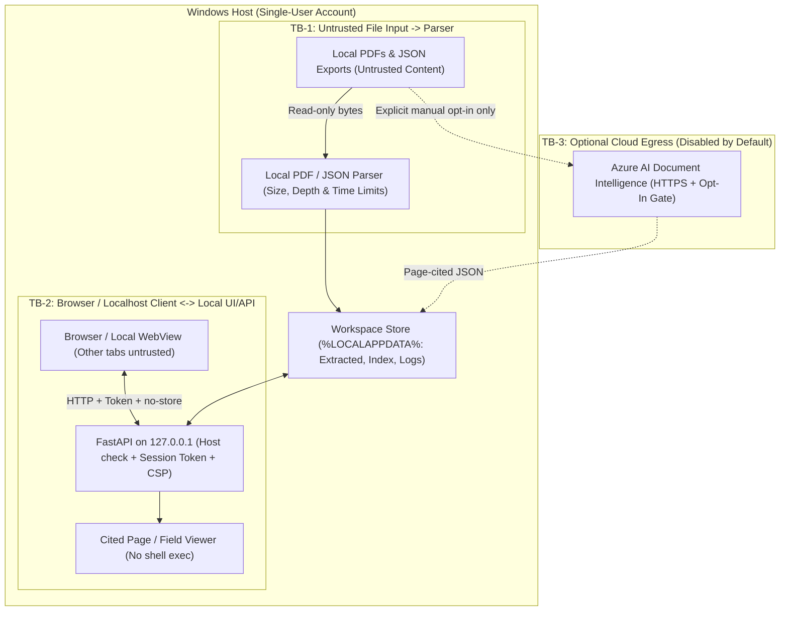

# Threat Model: Offline Document Intelligence Navigator (Windows-First, Single-User)

> Security design document distinguishing **current repository behavior** from **proposed Release 1 controls**. Uses public and synthetic examples only.

## 1. Scope & Security Objectives

This threat model covers the proposed **Windows-first, single-user, offline-by-default** document search application built on top of the Document Intelligence Navigator codebase, targeting IT security practitioners searching local ISMS documentation, internal policies, and JSON exports.

### Core Security Objectives

1. **Zero unintended cloud egress**: Confidential local ISMS files and search queries must never leave the Windows host unless the user explicitly invokes an opt-in cloud workflow on approved files.
2. **Safe parsing of untrusted/complex local files**: Malformed or adversarial PDFs and deeply nested/oversized JSON files must not achieve code execution, read arbitrary host files, leak NTLM credentials, or exhaust memory.
3. **Hardened localhost UI/API**: Local web exposure must resist cross-origin data theft, DNS rebinding, CSRF, XSS, and unsafe local file/command launches from other browser tabs or LAN peers.
4. **Controllable data lifecycle**: Practitioners must know everywhere document text, queries, and metadata can persist on Windows and be able to cleanly purge session artifacts.

### Trust Assumptions & Non-Goals

- **Assumed trusted**: The local Windows OS, kernel, BitLocker/disk encryption, and the currently logged-in Windows user account are assumed uncompromised. Any other process running under the *same* Windows user identity inherently has access to the user's files and loopback sockets.
- **Out of scope**: Defending against an already-compromised Windows user account (malware/EDR bypass on the same user session) or multi-tenant server isolation.

---

## 2. Assets to Protect

| Asset | Sensitivity | Why It Matters |
| --- | --- | --- |
| **Local ISMS PDFs, policies, and JSON exports** | High (Confidential / Internal) | May contain internal network diagrams, control gaps, audit findings, risk registers, incident procedures, or employee names. |
| **Extracted text, search indexes, and temp files** | High (inherits source sensitivity) | Plaintext extracts and FTS indexes expose the full searchable content of source documents even after original files are moved or encrypted elsewhere. |
| **Search queries & application logs** | Medium–High | Queries often name specific incidents, CVEs, systems, or suppliers; today `uvicorn` access logs capture query strings in `GET /api/v1/search?q=...`. |
| **Optional Azure AI Document Intelligence credentials** | High (Secret) | Today stored in plaintext `.env` (`document_intelligence.py`); unauthorized use incurs Azure billing charges or accesses tenant resources. |
| **Host filesystem & user account integrity** | High | Parser exploits, path traversal, or unsafe `open` handlers could read/modify unrelated files or execute binaries. |

---

## 3. Data Locations & Persistence Inventory

The table maps where sensitive data can exist **today** versus in **proposed Release 1**, including indirect Windows and browser side effects.

| Artifact | Exists Today | Proposed Release 1 Location (Windows) | Residual / Indirect Persistence Risk |
| --- | --- | --- | --- |
| **Originals** | `<repo>\data\raw\` (gitignored; manually placed PDFs or downloaded HTML). | Remain in user-chosen NTFS folders (read-only reference); optional session copies only under `%LOCALAPPDATA%\DocumentIntelligenceNavigator\sessions\<id>\copies\`. | User-managed backups (OneDrive sync, Windows Shadow Copies) may retain originals outside app control. |
| **Extracted text** | `<repo>\data\processed\*.document-intelligence.json`, `*.json`, `*.chunks.jsonl`. | `%LOCALAPPDATA%\DocumentIntelligenceNavigator\sessions\<id>\extracted\` with user-only NTFS ACLs. | Windows Search Indexer may index `%LOCALAPPDATA%` folders unless excluded or stored in non-indexed DB/temp paths; Recycle Bin if deleted via shell instead of direct unlink. |
| **Search indexes** | None (in-memory scan per request in `search.py`). | `%LOCALAPPDATA%\DocumentIntelligenceNavigator\sessions\<id>\index\` (e.g., SQLite FTS5 DB + WAL/SHM journal files). | SQLite `-wal` / `-shm` sidecar files and deleted SQLite pages retain old text until `VACUUM` or full file deletion. |
| **Temporary files** | Shared `%TEMP%` (Python/OS defaults); dev caches (`.pytest_cache`, `.ruff_cache`). | App-private `%LOCALAPPDATA%\DocumentIntelligenceNavigator\sessions\<id>\tmp\` (cleared immediately after parsing). | Crash mid-parse can leave orphaned temp files unless startup and cleanup routines sweep the `tmp\` folder. |
| **Logs & console output** | `uvicorn` logs full request URLs including `?q=...` to stdout; `scripts/demo_document_intelligence.py` prints `content[:2000]` to stdout. | `%LOCALAPPDATA%\DocumentIntelligenceNavigator\logs\` (redacted operational metadata only; no query strings, excerpts, or file contents). | PowerShell transcript/scrollback or browser DevTools/history if queries are sent via `GET` query parameters or logged to console. |
| **Browser / UI cache** | Browser default caching and history for `http://127.0.0.1:8000/search` and `/api/v1/search?q=...`. | Responses set `Cache-Control: no-store`, `Pragma: no-cache`; prefer `POST` body for search queries and/or an isolated WebView2 profile cleared on cleanup. | Standard browsers persist URL history and disk cache unless `no-store` and `POST` (or private/ephemeral WebView profiles) are used. |

---

## 4. Trust Boundaries

---

## 5. Threat Analysis by Trust Boundary

### 5.1 Trust Boundary 1: File Parsing (PDF & JSON Import)

Even local ISMS documents and JSON exports may originate from third-party vendors, auditors, or external scanning tools and must be treated as **untrusted input**.

| Threat (STRIDE) | Today vs. Proposed Exposure | Concrete Mitigation (Release 1) |
| --- | --- | --- |
| **Malformed PDF / Parser RCE or Crash** (Tampering / Elevation / DoS) | *Today*: PDFs are sent to Azure DI (`document_analysis.py`); no local PDF parser exists yet. *Proposed*: Introducing a local PDF library brings parser attack surface onto the laptop. | Enforce file-size and page-count limits; strip/ignore embedded PDF JavaScript, launch actions, and external URI triggers; consider running parsing in an isolated worker subprocess with a timeout and memory cap; evaluate pure-Python (`pypdf`) vs. native C (`pymupdf`) risk (see Section 7). |
| **JSON Nesting / Memory Bomb** (DoS) | *Today*: `search.py` calls `json.loads()` without size or depth bounds on `*.document-intelligence.json`. *Proposed*: Arbitrary user JSON exports can be huge or deeply nested. | Enforce maximum file size, maximum nesting depth, and node/field count caps before/during parsing; reject invalid UTF-8 cleanly with structured error messages. |
| **Path Traversal, Symlinks & Windows UNC NTLM Leak** (Info Disclosure / Spoofing) | *Today*: Demo script uses a static path; no user-supplied import path API exists yet. *Proposed*: Accepting user file/folder paths risks `..\` traversal, NTFS junctions/symlinks, or UNC paths (`\\evil-server\share\doc.pdf`) that silently leak Windows Net-NTLMv2 hashes over SMB. | Reject UNC paths (`\\...` / `//...`), device paths (`\\?\`, `\\.\`), and symlink/reparse-point escapes; resolve paths with `Path.resolve(strict=True)` and verify regular file type before reading; never accept raw filesystem paths from unauthenticated UI requests. |
| **Accidental Import of Secrets** (Info Disclosure) | *Today*: `.env` sits in repo root next to source code. *Proposed*: Folder import could sweep `.env`, key files, or unrelated dotfiles. | Restrict folder import strictly by allowlisted extensions (`.pdf`, `.json`) plus magic-byte / structure validation; explicitly skip `.env*`, `.git`, and hidden/system files. |

### 5.2 Trust Boundary 2: Local UI & API (`127.0.0.1` FastAPI + Browser)

| Threat (STRIDE) | Today vs. Proposed Exposure | Concrete Mitigation (Release 1) |
| --- | --- | --- |
| **LAN Exposure via Wildcard Bind** (Info Disclosure) | *Today*: `uvicorn` defaults to `127.0.0.1`, but nothing prevents launching with `--host 0.0.0.0`. | Hard-code default binding to `127.0.0.1` only; refuse non-loopback bindings unless an explicit unsafe dev flag is set (never in offline desktop launcher). |
| **Cross-Origin Theft, CSRF & DNS Rebinding** (Info Disclosure / Tampering) | *Today*: `main.py` has no `Host` validation, no session token, and uses unauthenticated `GET /api/v1/search`. A malicious site open in another browser tab could attempt DNS rebinding (`attacker.example` → `127.0.0.1`) to query local ISMS documents or invoke future import/cleanup endpoints. | Validate `Host` header strictly (`127.0.0.1:<port>` / `localhost:<port>`); do **not** enable wildcard CORS; generate a cryptographically random per-launch session token (`secrets.token_urlsafe(32)`) required on all `/api/*` calls; require `POST` + token for state-changing operations (import, open, cleanup). |
| **Cross-Site Scripting (XSS) via Excerpts or JSON Values** (Tampering / Info Disclosure) | *Today*: `search.html` safely uses `textContent` and restricts links to `https://`, which is a good foundation, but no Content-Security-Policy (CSP) header is sent. *Proposed*: Adding JSON viewers or highlight markup (`<mark>`) introduces XSS risk if `innerHTML` is used. | Never use `innerHTML` for document titles, filenames, excerpts, or JSON keys/values (construct highlight `<mark>` nodes via DOM APIs only); send strict response headers (`Content-Security-Policy: default-src 'self'; script-src 'self'; object-src 'none'; frame-ancestors 'none'`, `X-Content-Type-Options: nosniff`). |
| **Unsafe "Open Cited Page / Field" Action** (Elevation / Command Injection) | *Today*: Only external `https://` links exist in `search.html`. *Proposed*: Opening a local PDF at page *N* via shell commands (`os.startfile`, `cmd /c`, PowerShell) risks argument/command injection or launching non-PDF executables. | Identify documents solely by opaque server-generated `document_id` (UUID); verify canonical path and `.pdf`/`.json` type server-side; prefer an embedded in-app PDF/JSON viewer over OS shell execution, and if launching an external viewer, use `subprocess.run([...], shell=False)` with a validated executable path and no user-controlled flags. |
| **Query & Content Leakage via Logs / Browser Cache** (Info Disclosure) | *Today*: `GET /api/v1/search?q=...` records queries in `uvicorn` access logs and browser history; `scripts/demo_document_intelligence.py` prints extracted text to stdout. | Send `Cache-Control: no-store` on all API and viewer responses; move search requests to `POST /api/v1/search` (or disable query-string logging in `uvicorn`/app logging); never log document text, excerpts, or JSON payloads. |
| **Multi-User Windows Workstation Access** (Info Disclosure) | *Today*: Repo files inherit standard Windows folder permissions. | Store workspace data under `%LOCALAPPDATA%` (per-user profile) with explicit current-user-only NTFS ACLs; never write sensitive extracts to shared `C:\ProgramData` or `%PUBLIC%`. |

### 5.3 Trust Boundary 3: Optional Azure AI Document Intelligence Egress

| Threat (STRIDE) | Today vs. Proposed Exposure | Concrete Mitigation (Release 1) |
| --- | --- | --- |
| **Accidental Upload of Confidential ISMS Documents to Cloud** (Info Disclosure) | *Today*: Running `scripts/demo_document_intelligence.py` or calling `analyze_local_pdf()` sends raw PDF bytes directly to Azure whenever `.env` is populated. *Proposed*: Highest-impact confidentiality risk if a practitioner believes the app is offline. | **Offline-by-default kill switch**: Cloud extraction disabled unless explicitly enabled by configuration **and** confirmed per document with a clear UI warning naming the target Azure endpoint and stating that raw document bytes will leave the device. Never silently fall back to Azure when local PDF extraction finds empty text. |
| **Credential Exposure** (Info Disclosure / Spoofing) | *Today*: `document_intelligence.py` loads `AZURE_DOCUMENT_INTELLIGENCE_KEY` from plaintext `.env`. | Keep `.env` gitignored and never read/expose credentials to the browser UI or logs; for Release 1 opt-in cloud mode, prefer Windows Credential Manager / DPAPI or Entra ID (Managed Identity / interactive login) over plaintext `.env` keys. |
| **Data Residency & Retention Mismatch** (Compliance / Info Disclosure) | *Today*: Endpoint region depends on user's Azure resource setup. | Require explicit user awareness of the configured Azure region (e.g., EU region) and organisational approval before sending non-public documents; maintain [Source Policy](source-policy.md) separation so no private data enters the Git repository. |

---

## 6. Security Verification & Acceptance Checks

These checks extend the Release 1 acceptance criteria in [Product Brief](product-brief.md) with explicit security assertions using public or synthetic test fixtures.

| Check ID | Scenario | Security Assertions to Verify |
| --- | --- | --- |
| **SEC-1 (Disconnected Use)** | Network disabled (Airplane mode); `.env` absent; import synthetic PDF + JSON, search, open citation. | Zero outbound DNS/TCP/HTTPS attempts observed (e.g., via firewall log or Process Monitor); optional Azure extraction visibly disabled and blocked if invoked. |
| **SEC-2 (Page 5 Citation & Safe Render)** | Synthetic 8-page PDF (`synthetic-isms-policy.pdf`) containing `"Quarterly backup restoration drill"` plus literal `` text on page 5. | Search matches page 5; `<script>` renders as inert literal text (no JS execution); opening page 5 navigates directly to page 5 without shell invocation of arbitrary paths. |
| **SEC-3 (Nested JSON Match & Parser Safety)** | Synthetic nested JSON (`synthetic-isms-controls.json`) with target value at `/assessment/controls/1/evidence/notes`, plus benign HTML-like strings and a second synthetic negative fixture exceeding max nesting depth / size. | Valid nested match returns exact JSON Pointer and highlights the field safely with no HTML injection; oversized/over-nested fixture is rejected cleanly without crashing the server; UNC path input (`\\127.0.0.1\share\test.json`) is rejected before any file open. |
| **SEC-4 (Session Cleanup & Residue)** | After SEC-2 and SEC-3, invoke session cleanup. | Search returns `0` results; workspace `extracted/`, `index/`, `tmp/`, and session `logs/` contain zero files or zero occurrences of the synthetic marker strings; SQLite WAL/SHM files are removed; original files outside the app workspace remain intact. |

> **Known OS-level residual limits (documented transparently)**: Standard file deletion removes filesystem references on NTFS, but SSD wear-leveling, Windows pagefile/hibernation (`pagefile.sys`, `hiberfil.sys`), and Volume Shadow Copies may retain blocks until overwritten. Relying on OS-level **BitLocker full-disk encryption** is recommended on practitioner laptops.

---

## 7. Security Design Decisions Still Needing Evidence

| Open Security Decision | Trade-Offs & Unknowns | Evidence Needed Before Locking Implementation |
| --- | --- | --- |
| **PDF parser isolation vs. pure-Python safety** | Pure-Python parsers (`pypdf`, `pdfminer.six`) avoid C/C++ memory-corruption CVEs but may be slower or weaker on complex layouts; native parsers (`pymupdf`) are faster but expand memory-safety risk unless isolated in a separate subprocess/Job Object. | Test parser robustness against malformed PDF fuzz fixtures (truncated streams, recursive object refs, zip bombs) and measure overhead of running parsing in a short-lived Python subprocess with memory/time limits on Windows. |
| **Localhost auth UX vs. DNS rebinding resistance** | Per-launch random token in URL fragment + `POST` header blocks cross-tab/DNS-rebinding attacks cleanly, but requires careful handling so the token is not leaked via `Referer` headers or browser history. | Prototype launch flow on Windows (system browser vs. embedded WebView2) and verify `Host` header check + token exchange with automated security tests. |
| **System browser vs. isolated WebView2 profile** | Opening `http://127.0.0.1` in Chrome/Edge reuses the user's daily browser (shared history/extensions/autocomplete); an isolated WebView2 profile can be wiped on session cleanup but adds packaging weight. | Evaluate extension/history leakage and cleanup completeness in a spike comparing Edge/Chrome with `Cache-Control: no-store` + `POST` search vs. an ephemeral WebView2 window. |
| **Workspace encryption (BitLocker-only vs. DPAPI / SQLCipher)** | App-layer encryption protects extracted text/indexes from offline disk inspection even without BitLocker, but SQLCipher complicates Windows Python packaging and key lifecycle. | Confirm target practitioners' endpoint baseline (whether corporate BitLocker is universal) and evaluate SQLCipher/DPAPI wheel availability for Python 3.12 on Windows. |
| **Secure deletion vs. standard unlink on NTFS/SSD** | Multi-pass overwriting is ineffective on modern SSDs and adds wear, whereas deleting the index DB file + relying on BitLocker is fast and standard. | Confirm with practitioner security requirements whether single-pass removal + SQLite `SECURE_DELETE` pragma + BitLocker recommendation satisfies internal ISMS handling rules. |
| **`GET` vs. `POST` for `/api/v1/search`** | Current `main.py` uses `GET /api/v1/search?q=...` (simple to test with `Invoke-RestMethod`), but `GET` query strings easily leak into access logs and browser history. | Decide whether to migrate the local UI to `POST /api/v1/search` with JSON body while disabling query-string logging (or keeping `GET` strictly for non-sensitive public demo mode). |
